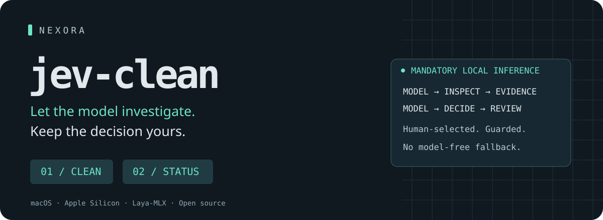
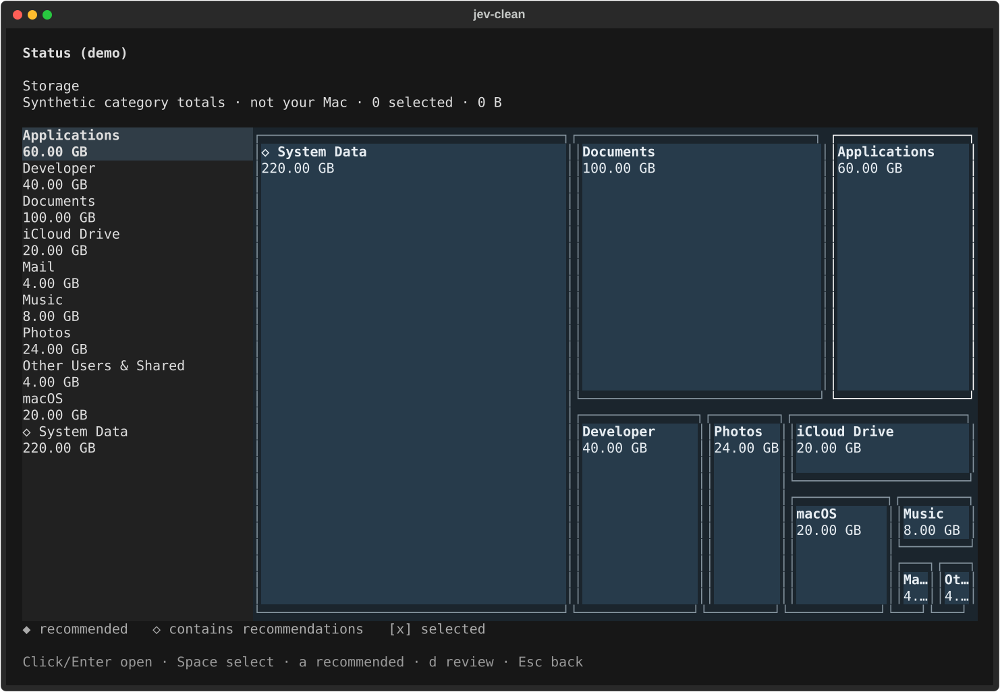
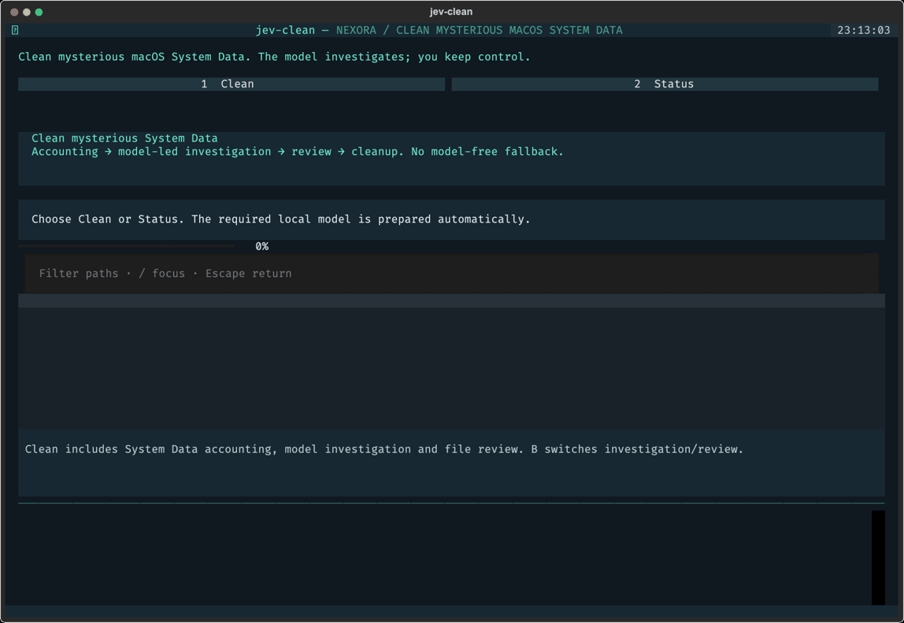

<p align="center"></p>

# jev-clean · Nexora

**Local development: 0.4.0.dev5 — interactive Status treemap and actual-path Clean.** Command actions are not file rows and command-store allocation is excluded from proposed file totals. Native parallel measurements replace millions of per-file model calls. See [ADR 0006](docs/adr/0006-resource-first-cleanup.md). The published v0.3.0 installer below still installs the older engine. This local preview requires its SHA-verified trained adapter: `python3 install.py --source . --adapter /path/to/verified/model.safetensors`. There is no public preview model download or manual model-free fallback.

**Local post-training update:** the source preview uses the v3 learned Laya adapter on the existing observation interface. Scanner, prompts, probability ensemble, selection, and execution code are unchanged; only weight-provenance pins change. Authored native controls and remaining single-order errors are recorded in [Post-training research](docs/POSTTRAINING-PARITY.md). Existing custom roots and Status drill-down remain the way to expose a smaller resource inside a mixed parent.

**Clean the mysterious “System Data” on your Mac—with a local model doing the investigation.**

[](https://github.com/chengyixu/jev-clean/actions/workflows/ci.yml)
[](LICENSE)


macOS calls hundreds of gigabytes **System Data**. That label doesn't tell you what the data is, why it exists, or whether you can remove it.

**Clean is the flagship System Data workflow.** The terminal stays simple:

```text
1. Clean
2. Status
```

**Clean:** sudo or not → native resource inventory + model assessment → select resources → seal exact contents → confirm or cancel.

**Status:** whole startup-disk scan + model assessment → Apple-named treemap → click/Enter nested maps → `A` select recommended actual paths → `D` review. Recorded macOS category totals and estimated path groups are separate. [Research and limits](docs/STATUS-TREEMAP.md).

<p align="center"></p>

**Learned Laya decisions, not folder blacklists.** Native Laya's final encoder layers and decision head were adapted on counterfactual observation cases; arbitrary filenames/paths do not enter cleanup inference. Batched reordered choices reduce option bias. Cache tags are observations, not permission gates. Verified storage-purpose facts help Laya judge actual cache subtrees. Owner-tool operations stay separate technical advisories, not cleanup-path checkboxes. [Research, raw failures and limits](docs/DEEPER-LAYA-RESEARCH.md). Known limitation: a 24-scenario diagnostic answered 16/24 with structured input and included two incorrect-remove answers, so **review every proposed file**. See [ADR 0005](docs/adr/0005-model-owned-judgment.md) and [model-authority-evaluation.json](docs/model-authority-evaluation.json).

**Resources, not millions of neural file judgments.** Both modes cover the declared mounted startup scope with disjoint directory/file resources. Four native workers measure subtrees; Laya decides per resource. Exact descendant metadata is collected only for selected review. Each native measurement has a 10-second deadline; failures remain explicit gaps, not zero-byte success. No total-resource sampling cap. [Current contract](docs/PRODUCT.md).

Clean stays a compact checkbox checklist. Status has a nested proportional map and keyboard-equivalent list; detailed source/evidence is available on demand and in private JSON.

Laya prioritizes volume inspection, classifies the evidence, and proposes what to keep or remove. You see the actual choices and scores as they happen. You approve the files. Raw model choices stay in the audit; execution requires model approval, exact target/operation verification and your confirmation. A cache-like name alone is not evidence.

> **Alpha software.** No model = no Clean or Status operation. There is no rules-only fallback. Model scores are **not deletion-safety guarantees**. Begin with the real-inference demo and review [SECURITY.md](SECURITY.md). The project name does not imply affiliation with TypeSafe AI; the shipped engine is Laya-MLX.

<p align="center"></p>

*Historical v0.2.0 TUI walkthrough with real local inference and synthetic filesystem metadata. It illustrates navigation, not v0.3.0 model answers. This is a screen sequence, not real-time playback. No private files or canned neural scores.*

## Two modes. The model drives both.

| | **Clean** | **Status** |
|---|---|---|
| Question | “What can I remove to tackle mysterious System Data?” | “Where is the space actually going?” |
| Model’s job | Prioritize scope → assess measured resources → propose remove / review / keep | Assess the full filesystem scope → classify storage → expose unresolved areas |
| Tools’ job | Stream filesystem metadata, not recommendations | Inventory full scope; collect native/APFS evidence |
| Your control | Select approved paths; review and confirm | Drill down; select recommendations; D reviews with explicit confirmation |
| Result | System Data context + model findings + selected cleanup + receipt/undo | Private JSON report and model decision trace |

**The loop:** model prioritizes → tools walk every declared root → model assesses factual evidence → you review. Clean shows only selectable items with `[ ]` / `[x]`. Other model decisions and measurement diagnostics stay in the JSON report, not the checklist. Esc pauses; restarting re-enumerates with exact prior decisions reused. The default no longer waits for millions of per-file inferences. The mover supports current-user files and reviewed directory resources, with unchanged identity, no-follow metadata manifests and no-overwrite undo. It never classifies trash. App-native dependency investigation and permanent pruning are not implemented.

### Honest about the gray bar

Where available, jev-clean reconciles a same-timestamp native record:

```text
Used space − macOS − named categories = System Data (“Other”)
```

The displayed System Data number is labeled **macOS log + recorded time**. Press `S` for its exact bytes/source/timestamp. It is a native historical reading, not a hardcoded total or a promise of instant freshness.

It keeps that accounting separate from filesystem allocation. Nested directories overlap; sparse VM files and APFS clones complicate reclaim estimates. Large folders are **not automatically proven members of System Data**. Unavailable native logs, permissions gaps and unexplored branches remain visible. No invented “263 GB explained” headline.

## Install

Requires **Apple Silicon macOS** and `python3` to run the installer. It provisions uv if needed, an isolated Python 3.12 app environment, and the required model automatically. The underlying MLX runtime declares macOS 14+ support; live inference is tested here on macOS 27.0. Intel Macs and Linux cannot run the application model.

```bash
d="$(mktemp -d)" && curl -fL https://github.com/chengyixu/jev-clean/releases/download/v0.3.0/install.py -o "$d/install.py" && python3 "$d/install.py"
jev-clean
```

**One install flow: app → pinned model (~0.85 GB) → checksum verification → real inference test → Ready.** No separate model-setup command. The installer exits with failure if the model cannot be provisioned or run; it never calls an app-only installation complete. Review the [installer source](install.py) and release checksums if desired. It prints the exact launch path if your uv executable directory is not on PATH.

No API key, cloud inference, account, daemon, password capture or sudoers change. Run the installer and app **without sudo**. After installation, inference is local. Advanced direct-package installs also automatically provision missing weights on the first Clean/Status operation; network/download failure stops the operation, never produces a fallback.

### Try the model without touching your files

```bash
jev-clean clean --demo
jev-clean status --demo
```

The demo feeds synthetic disk metadata through **real mandatory Laya inference**. It cannot move real files. An incomplete model cache is provisioned automatically; failed provisioning stops the operation.

### Permission flow

Clean asks **“Use sudo?”** with Yes/No; No is the default. Yes returns to the real terminal for `sudo -v`. Passwords never enter Python, the agent or the model. Cancelling starts no scan. Status goes straight to read-only agent logs and results. Sudo broadens read-only evidence—not deletion power—and does not bypass SIP, TCC or Full Disk Access.

## Agent skill and JSON CLI

The agent skill uses the exact same engine and safety boundaries. Install/link the [skill directory](skills/jev-clean) using your agent's skill manager, then invoke `/jev-clean` or ask it to inspect disk usage.

```bash
jev-clean status --json
jev-clean status --json --root "$HOME/Library/Application Support"
jev-clean clean --json --root "$HOME/Library/Caches" \
  --output "$HOME/.local/state/jev-clean/review.json"

# Optional deeper native READ access: human authenticates in their own terminal.
sudo -v
jev-clean status --deep --json

# ONLY after the human reviews and approves these particular IDs:
jev-clean apply "$HOME/.local/state/jev-clean/review.json" \
  --ids ID1,ID2 --confirm TRASH
```

`--root` selects an explicitly labeled custom scope, not deletion permissions. With no `--root`, the entire mounted startup-container scope is attempted. The JSON `system_data` section carries native total/residual, source/time, candidate bytes and attribution limits for **both** modes. `exploration.stats` separates resources discovered/measured, fresh/reused model decisions, measurement gaps and proposed bytes. Descendants are not reported as individually AI-assessed. Zero approvals does not mean “nothing to clean.” It can reflect missing evidence, model error/retention or execution limits. Plans expire in one hour. Every chosen file needs a `remove` decision and technical staging readiness; applying a plan collects fresh evidence, re-runs model assessment and checks identity/activity. Invalid or missing model output stops the operation. Reports contain private paths: **do not upload them**.

## Controls and utilities

| Key | Action |
|---|---|
| `1` / `2` | Clean System Data / Status |
| `↑ ↓` or `j k` | Navigate |
| `← →`, then `Enter` | Choose Yes/No in the sudo and deletion questions |
| `S` | Show exact native System Data bytes, source and recorded timestamp |
| `Space` | Toggle a model-approved, safety-checked file |
| `A` / `N` | Clean: all visible approved; Status: all known approved actual paths / none |
| `/` | Filter paths |
| `Enter` | Clean: confirm selected paths; Status: open the focused category/directory |
| `D` | Status: review selected paths; No is the final dialog default |
| `R` | New model investigation |
| `E` | Export private report |
| `H` | History and undo instructions |
| `U` | Check release updates |
| `?` / `Esc` / `Q` | Help / back or cancel / quit |

Status uses proportional rectangles. Top-level native category areas are recorded totals; clicking a category switches to **observed allocations in estimated category paths**, not an exact Apple breakdown or APFS-exclusive space. Unattributed paths stay separate. Green `◆` means Laya recommends a resource; `◇` means a container contains recommendations; `[x]`/amber means selected. Zero/unknown/tiny blocks remain reachable by keyboard. Esc returns one level. Selection and resize preserve IDs; no click or selection key deletes files.

```bash
jev-clean doctor
jev-clean history
jev-clean restore BATCH_ID --confirm RESTORE
jev-clean update           # check only
jev-clean update --apply   # confirm update; model provision + inference verified before ready
jev-clean completion zsh   # also bash and fish; prints, doesn't modify shell config
```

The deletion question defaults to **No**. Only an explicit Yes proceeds with the selected paths and the existing model/safety rechecks.

**Trash is not free space.** Staging is reversible; it does not immediately reclaim bytes. jev-clean never automatically empties Trash. Restore refuses to overwrite an existing file. Owner-native pruning, when explicitly selected, is different: the final dialog states it cannot be undone, and CLI plans require `--confirm CLEAN` rather than `TRASH`.

## Why Laya-MLX?

Laya is a typed-decision encoder: one bounded question goes in, a choice distribution comes out. No token-by-token prose or model-generated shell code. The pinned [aac6fef/laya-mlx](https://huggingface.co/aac6fef/laya-mlx) checkpoint runs natively with MLX on Apple Silicon.

We researched the English, multilingual and typed-decision Laya families plus open Jev reproductions. “Jev” search results are not a single interchangeable model. See [the source-linked research](docs/RESEARCH.md), [architecture decision](docs/adr/0001-local-decisions.md) and [product contract](docs/PRODUCT.md).

### What the measurements actually say

Historical v0.1/v0.2 evidence: a local 12-case synthetic-metadata diagnostic produced **7/12 exact expected choices**. None of the nine protected/uncertain fixtures became selectable; **that is the combined model-plus-veto result, not proof that the model is safe**. Model proposals can be wrong. The diagnostic is small, hand-authored and related to prompt-development examples—not an independent accuracy benchmark. Raw outputs, timings, mismatches and limitations are published in [model-evaluation.json](docs/model-evaluation.json).

Version 0.3.0 evidence: the 24-scenario structured-input diagnostic answered **16/24**, with **two false-remove answers**, including a unique private key and required offline model weights. No type veto masks these errors. These small authored examples are not an accuracy benchmark; the results were reviewed and accepted before release. Reproduce with `uv run python scripts/evaluate_model_authority.py --output .private/authority.json`.

We do not claim superior cleanup accuracy to Mole or that local inference understands every file. The distinction is a visible, mandatory model-driven investigation and a strict human-controlled execution boundary.

## Safety scope

- No root deletion, recursive permanent deletion, uninstall scripts or automatic Trash emptying. Directory staging includes all descendants and requires a reviewed manifest.
- Databases, VM disks, model weights, source work, credentials and backups are not blanket cleanup targets.
- Read/model scope is the mounted startup disk. Trained Laya decides from structural/activity/tool observations, not path names or tag-based authorization.
- Current-user file/resource staging checks canonical paths, owner, device/inode/size/mtime/ctime/link count, refreshed activity and directory membership.
- Unknown activity is model evidence; unavailable exact target metadata is an execution limitation, not a keep judgment.
- Model decisions are mandatory. Only valid remove answers with technical staging readiness can be selected.
- Same-user concurrent writers remain a race risk. Close relevant apps before cleanup. See [threat model](SECURITY.md).

## Develop / reproduce

```bash
git clone https://github.com/chengyixu/jev-clean.git
cd jev-clean
uv sync --frozen --extra dev --python 3.12
uv run bash scripts/verify.sh
uv run python scripts/evaluate_model.py --output docs/model-evaluation.json  # cold cache provisions automatically
uv run python scripts/capture_demo.py
```

Hermetic tests use temporary directories and an explicit neural-adapter test double; the application has no fake-model switch. Real-inference evaluation and media capture automatically provision a missing checkpoint, just like the app. On macOS, PNG/GIF rendering needs Cairo discoverable (e.g. `DYLD_FALLBACK_LIBRARY_PATH="$(brew --prefix)/lib"`). The SVG screenshots do not require Cairo.

## License and credits

Apache-2.0. A **Nexora** project. Laya by Convai Innovations; independent MLX port by mizorewww/aac6fef. Mole's documented interface informed the research; no Mole source or artwork was copied. See [NOTICE](NOTICE).
